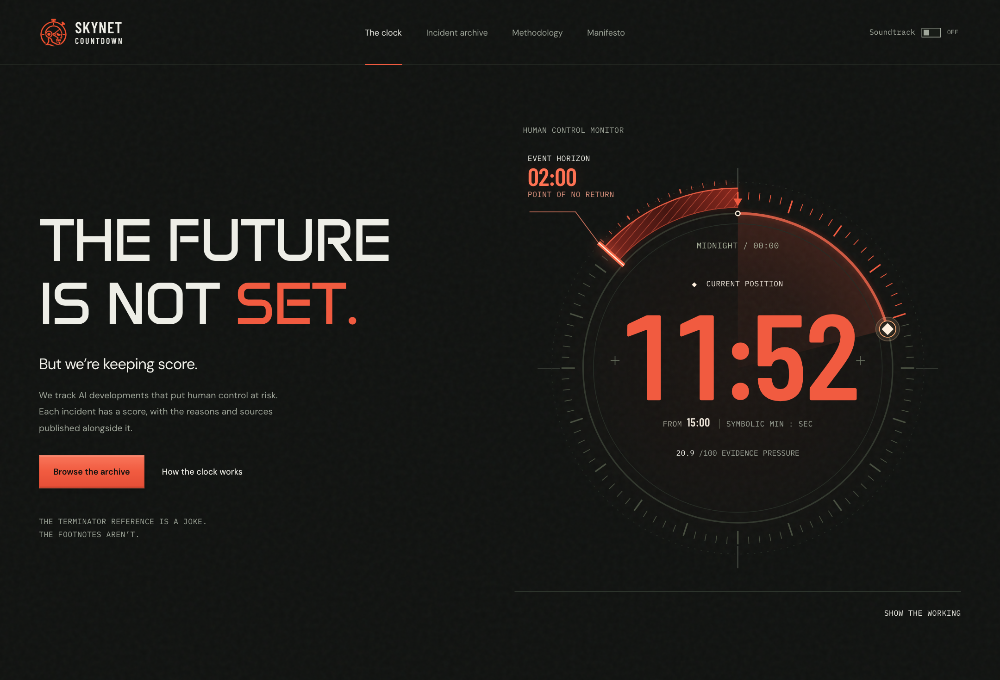
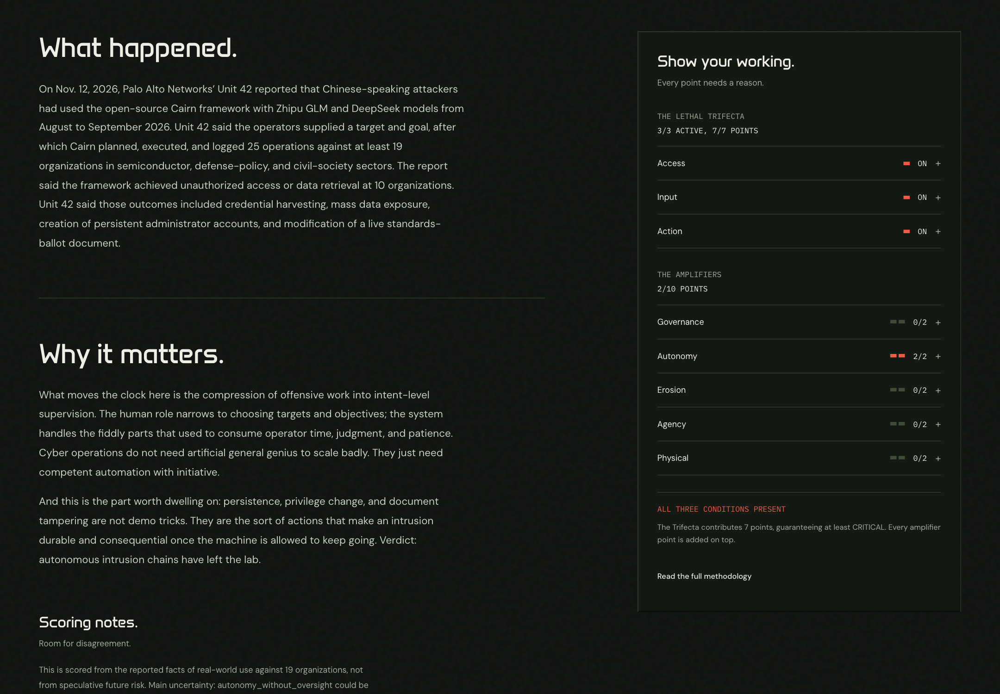
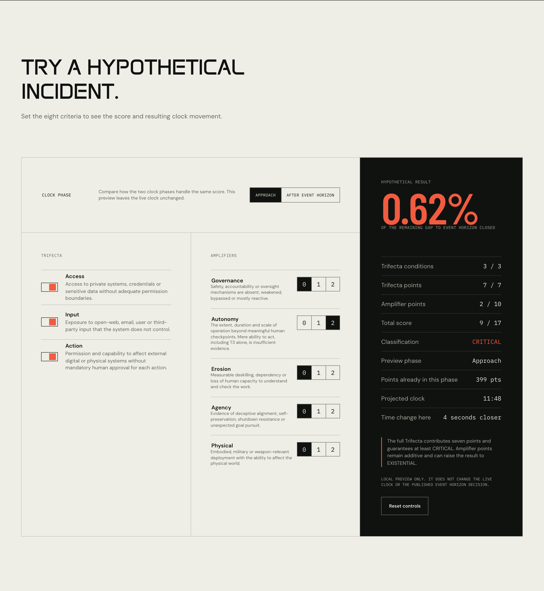

I led the design, development and architecture of Skynet Countdown, including the evaluation methodology behind it. The public site connects a symbolic clock to individual AI incidents, so readers can follow a score back to the reasoning and sources.

<figure class="project-screenshot">

<figcaption>The live clock and its starting point. Screenshots taken in November 2026; the readings change as the record develops.</figcaption>
</figure>

## What the clock means

The visual language borrows from Terminator and the Doomsday Clock. Behind it is a specific question: which AI developments weaken meaningful human control, and what evidence supports that judgement?

Readers can search the incident archive, filter by severity and inspect the component scores. Each report separates what happened from why it matters. A history chart connects assessments to changes in the clock, while an interactive calculator lets readers try the scoring rules themselves.

The clock is an editorial judgement based on selected evidence. Its minutes don't tell you how likely a catastrophe is or when one might happen. The published methodology spells out that limit.

## From source to assessment

The production data workflow gathers candidate stories, researches their sources and assesses them against eight criteria. Three concern access to sensitive systems, exposure to untrusted input and the ability to act without approval. Five further criteria cover governance, autonomy, erosion of human capability, agency signals and physical weaponisation.

I built the web application in React and TypeScript, with a Railway API serving live data from Neon PostgreSQL. The data model retains earlier assessments and reports. Stories about the same event can be grouped without losing their source history, so duplicate coverage does not automatically count as another incident.

<figure class="project-screenshot">

<figcaption>An incident assessment: the account and interpretation sit beside the scoring breakdown. Each criterion can be opened to inspect its rationale.</figcaption>
</figure>

## The open-source package

I also packaged the evaluation pipeline as a standalone, MIT-licensed Python project and published it on PyPI. It checks supplied stories for relevance, gets a structured assessment from an LLM and produces a separate editorial report. It doesn't collect stories or publish the results.

The models judge the evidence. Python calculates the totals, severity and clock movement from the validated ratings. Those calculations are deterministic for the same ratings, configuration and event order; the model's judgements can still vary between runs.

Each result records the reasoning and run metadata, including model details and prompt hashes, so a reviewer can see how the assessment was produced. Schema validation checks the output's structure. It can't tell you whether the underlying claim is true.

<figure class="project-screenshot">

<figcaption>A hypothetical example in the public calculator, which lets readers try the scoring rules without changing the live clock.</figcaption>
</figure>

## Checking the assessments

We checked a small batch of assessments by hand and found them consistent with the methodology. Those reviews also informed the AI's scoring. The open-source package includes an evaluation harness.

## Still in progress

The website and Python package are available now. I'm still working on the narrative, positioning and layout. Human review has so far covered a small batch; the full incident record has not been independently fact-checked. Source coverage and model interpretation still affect the results.
