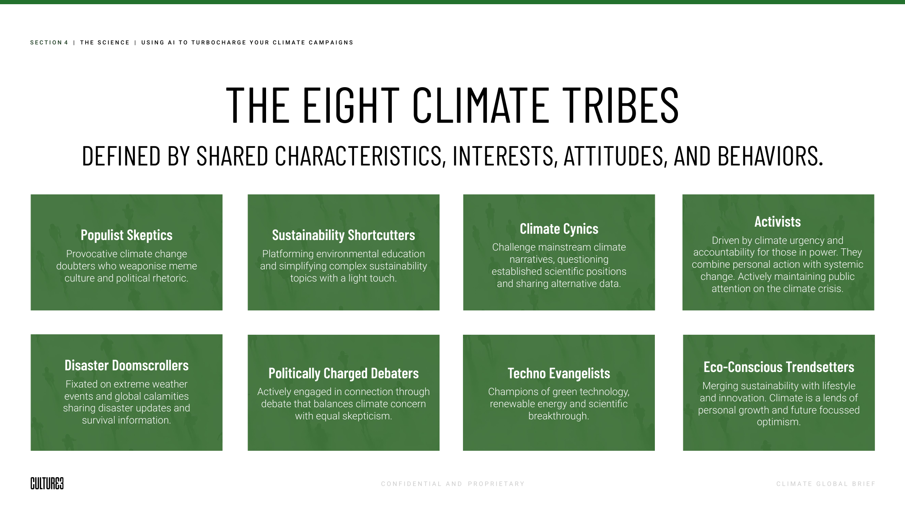
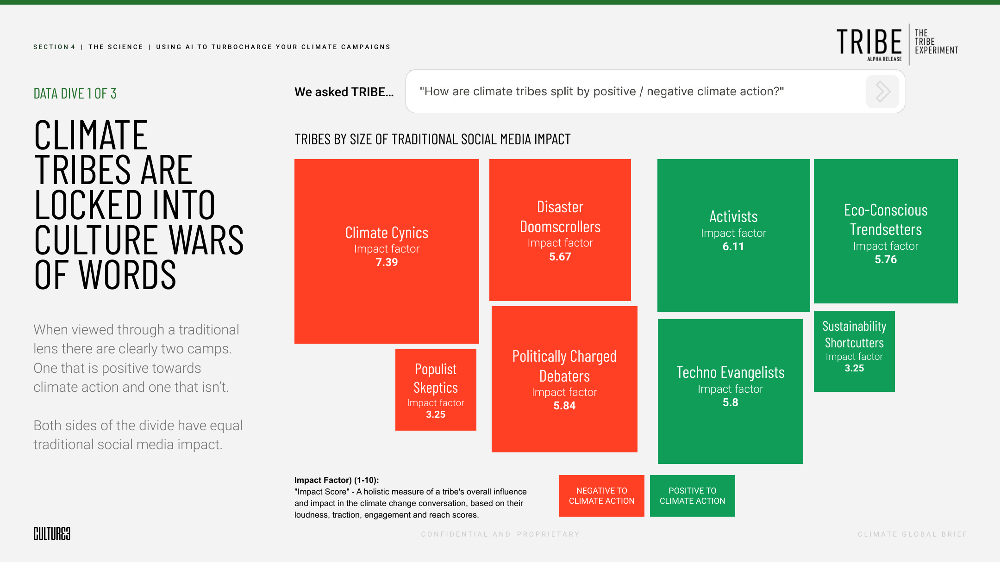
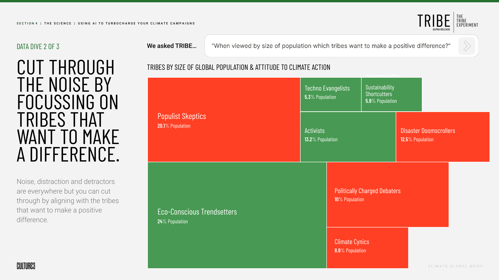
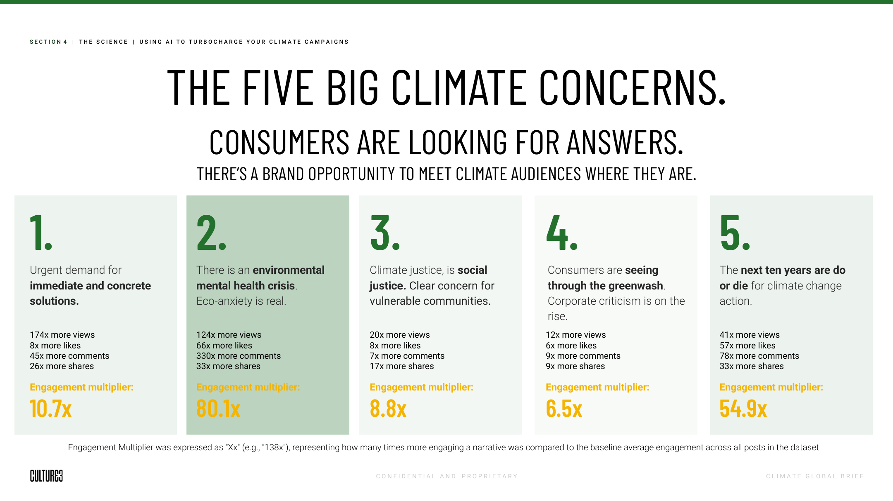

TED wanted to help brands engage with climate change without sounding like they were chasing a trend. I led the project at Braidr with a team of machine learning and data engineers. We built T.R.I.B.E. (Tribal Resonance Intelligence Behavioural Engine) to study cultural communities through public social-media conversations.

We started with a fairly rebellious critique of brands in climate conversations. The brief later shifted towards helping companies use those insights responsibly, without trying to monetise the apocalypse. Our research contributed to a report produced with TED, social activist and Oscar nominee Misan Harriman, Dr Marcus Collins, creative consultancy Conspirators and lead strategist, Joe McLewin.

<figure class="project-testimonial">
<blockquote>
“The depth of insight from this analysis is groundbreaking. By understanding how cultural tribes engage with climate change, we can empower brands to craft authentic and impactful sustainability messaging that resonates deeply.”
</blockquote>
<figcaption>Lilian Beatty, Global Partnerships, TED. Excerpt from her feedback on the work.</figcaption>
</figure>

## My role and the team

I led the architecture and engineering, analysed the data and developed the findings. A machine learning engineer and a data engineer worked alongside me.

I worked with a strategist and project manager, our creative agency partner Conspirators, TED's Global Partnerships stakeholder and internal C-suite stakeholders.

## Finding the climate tribes

We adapted the idea of cultural congregations in Dr Marcus Collins' <em>For the Culture</em> into tribes: groups connected by shared beliefs, language and ways of behaving. We grouped accounts by those signals and used model-inferred demographics to describe the groups.

The study analysed public posts and comments in many languages across Facebook, X, TikTok and YouTube. We used <a href="https://huggingface.co/intfloat/multilingual-e5-large" target="_blank" rel="noopener noreferrer" data-goatcounter-click="project_tribe_multilingual_e5_clicked" data-goatcounter-no-session="1">intfloat/multilingual-e5-large</a> to represent meaning across languages, alongside embedding models chosen for short, informal social-media text. We clustered accounts by those representations and used noise analysis to evaluate the resulting groups. Those became tribes such as Disaster Doomscrollers and Eco-Conscious Trendsetters: our interpretation of patterns in the conversations.

For demographic context, we extended the <a href="https://github.com/euagendas/m3inference" target="_blank" rel="noopener noreferrer" data-goatcounter-click="project_tribe_m3_inference_clicked" data-goatcounter-no-session="1">m3-inference</a> project to work across our broader mix of data sources. Its age, gender and account-type estimates helped describe the groups. We manually checked demographic predictions against known creator profiles to assess inference accuracy. Across the wider dataset, these remained model-inferred labels.

<figure class="project-screenshot">

<figcaption>The eight tribes, on page 15 of the downloadable report. They describe patterns in the collected conversations.</figcaption>
</figure>

## Two views of the same tribes

We compared the tribes by social-media impact and by estimated audience size. Those views answer different questions. A group can dominate the conversation without representing the largest audience.

<figure class="project-screenshot">

<figcaption>Page 16 of the downloadable report. The impact score combines posting activity, views, follower counts and active engagement. This view gives the two sides broadly comparable weight in the conversation.</figcaption>
</figure>

<figure class="project-screenshot">

<figcaption>Page 17 of the downloadable report. Weighting for gender and geography gives a different view: Eco-Conscious Trendsetters account for an estimated 24% of the modelled climate-engaged audience. The population assumptions are explained below.</figcaption>
</figure>

## Building the research system

We used graph RAG to preserve the relationships between comments, parent posts and anonymised user records. Retrieval could then follow those connections and put a comment in its wider discussion context. <a href="https://docs.datastax.com/en/astra-db-serverless/get-started/astra-db-introduction.html" target="_blank" rel="noopener noreferrer" data-goatcounter-click="project_tribe_astra_docs_clicked" data-goatcounter-no-session="1">DataStax Astra DB, built on Apache Cassandra</a>, provided scalable storage with vector search and metadata filters for efficient retrieval.

LangChain ran on Google Cloud Platform (GCP) to coordinate retrieval and model calls. A comparable approach is described in <a href="https://docs.cloud.google.com/architecture/agentic-ai-multimodal-graph-rag-resource-orchestration#search-workflow" target="_blank" rel="noopener noreferrer" data-goatcounter-click="project_tribe_graph_rag_reference_clicked" data-goatcounter-no-session="1">Google Cloud's graph RAG reference architecture</a>.

<figure class="architecture">
<ol class="agent-flow">
<li>01 / COLLECT<strong>Public conversations</strong>Apify and Zyte handled collection across sources. The YouTube Data API provided structured video and comment data.</li>
<li>02 / MODEL<strong>Multilingual audiences</strong>Embeddings represented multilingual and short-form text. Scikit-learn supplied clustering and checks on cluster separation.</li>
<li>03 / RETRIEVE<strong>Connected evidence</strong>Cassandra-backed Astra DB supported scalable storage and vector retrieval. Graph links preserved comment, post and user relationships.</li>
<li>04 / ANALYSE<strong>Questions and follow-ups</strong>LangChain on GCP coordinated retrieval and model calls. GPT-4 and Claude Opus let us compare interpretations of the evidence.</li>
</ol>
<figcaption>The delivered architecture, with graph relationships retained through retrieval.</figcaption>
</figure>

The retrieval-augmented generation (RAG) layer supplied 50–100 relevant posts or comments per question. Using two models let us compare interpretations, though agreement between them was no guarantee of accuracy. The retrieval limit mattered too: a relevant selection can still miss an unusual or dissenting view.

## Using the app

The demo lets people ask about tribes, explore how they interact and follow an answer back to the supporting source material. The app keeps the context for follow-up questions.

<figure class="project-screenshot">

<figcaption>The demo answering a question about how Eco-Conscious Trendsetters engage with climate conversations.</figcaption>
</figure>

You can also try draft messages against each tribe. The responses can help a team refine a message before testing it with real audiences.

We anonymised personal identifiers and kept analysis and reporting at tribe level. The work examined collective patterns; it did not target individuals or reveal their profiles. Graph relationships supplied context for the research without making personal identity part of the output.

## Climate change and mental health

The conversations we analysed included eco-anxiety, doomscrolling and worries about the future, particularly among younger generations. That mental-health theme was our headline finding. The report described it as an environmental mental-health crisis within the climate conversation.

<figure class="project-screenshot">

<figcaption>Page 14 of the downloadable report. Engagement multipliers compare selected narrative posts with the dataset baseline; they are not measured campaign results.</figcaption>
</figure>

That finding concerns how people discussed climate change in this sample. It does not establish clinical prevalence or causation. The narrative metrics used the 25 most relevant retrieved posts, so their engagement figures also need to be read as comparisons within that selection.

## What the sample could support

The dashboard separates collected activity from population estimates. Of the 110,241 accounts, 93,695 were assigned to the eight tribes; the rest were brand or unclassified accounts. Aggregate views were recorded separately from likes, comments and shares. A view count is not a count of unique people.

For the population model, we weighted the sample by gender and geography, then applied an assumed 24% rate of engagement with climate discussion. The model also assumed a 50/50 gender split. The dashboard shows the raw and adjusted estimates separately so those assumptions can be inspected.

Weighting adjusts for the gender and geographic skew in the sample. It cannot recover missing conversations, make inferred demographics certain or turn a platform-selected sample into a random survey. I'd treat the population figures as exploratory estimates. Population-level precision would need validation against an independent sample.

We delivered a research report and a working platform for TED to query the underlying data. The download contains 22 selected report slides, including the two views above, and a cover with their original page numbers.
